


 


 


 


 

<a href="https://darshilnathwani.netlify.app"></a>
<a href="https://crickraft.vinaedutech.com/"></a>
<a href="https://strengthkraft.vinaedutech.com/"></a>
<a href="https://indianchessacad.com"></a>
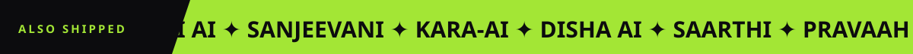

<a href="https://github.com/Darshil-N/Raahi">Raahi</a> ·
<a href="https://github.com/Darshil-N/Siddhi-Ai">Siddhi AI</a> ·
<a href="https://github.com/Darshil-N/Sanjeevani">Sanjeevani</a> ·
<a href="https://github.com/Darshil-N/Kara-Ai">Kara-AI</a> ·
<a href="https://github.com/Darshil-N/Nasiko_Buildathon">Disha AI</a> ·
<a href="https://github.com/Darshil-N/Saarthi">Saarthi</a> ·
<a href="https://github.com/Darshil-N/Pravaah-AI-">Pravaah AI</a> ·
<a href="https://github.com/Darshil-N/Netra">Netra</a> ·
<a href="https://velvetacademy.org/">Velvet Academy</a>

  

 

