<div align="center">



<a href="https://github.com/Darshil-N">
  
</a>

<br/><br/>

<a href="https://darshilnathwani.netlify.app"></a>
<a href="https://www.linkedin.com/in/darshil-nathwani-bba698307/"></a>
<a href="mailto:darshilnathwani@gmail.com"></a>
<br/>

<a href="https://github.com/Darshil-N?tab=followers"></a>

<br/><br/>


</div>

<br/>

## ✦ ABOUT

```python
darshil = {
    "role"       : "AI & Full Stack Developer",
    "focus"      : ["AI Systems", "Multi-Agent Frameworks", "RAG Pipelines", "Web3"],
    "currently"  : "Full Stack Developer Intern @ Indian Chess Academy (Vina EduTech)",
    "research"   : "Drishti-AI — NL-driven campus incident analysis via DeepSeek Text-to-SQL",
    "education"  : "B.E. Information Science @ DSCE, Bengaluru",
    "interests"  : ["Agentic AI", "Cybersecurity", "Machine Learning", "Scalable Systems"],
    "mantra"     : "Ship fast. Learn always. Build with impact."
}
```


## ✦ TECH STACK

<sub>**LANGUAGES**</sub>


<sub>**AI / ML**</sub>

<p>
  
  
  
  
  
  
  
  
</p>

<sub>**FRAMEWORKS & FRONTEND**</sub>

<p>
  
  
  
</p>

<sub>**DATABASES**</sub>

<p>
  
  
  
</p>

<sub>**TOOLS & DEVOPS**</sub>


<sub>**SECURITY**</sub>

<p>
  
  
  
  
</p>

<sub>**BLOCKCHAIN**</sub>

<p>
  
  
  
  
</p>


## ✦ BY THE NUMBERS

<div align="center">


<br/>


<br/><br/>


</div>


## ✦ FEATURED PROJECTS

<table align="center">
  <tr>
    <td width="50%" valign="top">
      <h3 align="center">⛓️ Raahi — Blockchain Tourist Safety</h3>
      <p align="center">
        <a href="https://github.com/Darshil-N/Raahi" target="_blank">
          
        </a>
      </p>
      <p align="center">
        <b>Top 50 — SIH 2025.</b> Blockchain safety platform on Polygon using NFC smart-wristbands as digital IDs. Immutable incident logging via smart contracts, offline SMS fallback and real-time emergency response.
      </p>
      <p align="center">
        
        
        
        
      </p>
    </td>
    <td width="50%" valign="top">
      <h3 align="center">💳 Siddhi AI — Credit Scoring</h3>
      <p align="center">
        <a href="https://github.com/Darshil-N/Siddhi-AI" target="_blank">
          
        </a>
      </p>
      <p align="center">
        Trained on <b>1.8M loan repayment records</b> with XGBoost at 96.8% accuracy. Reads alternative consumption data (utility bills, rentals) to enable secure digital lending for NBCFDC.
      </p>
      <p align="center">
        
        
        
        
      </p>
    </td>
  </tr>
  <tr>
    <td width="50%" valign="top">
      <h3 align="center">🏥 Sanjeevani — ICU Diagnostic Assistant</h3>
      <p align="center">
        <a href="https://github.com/Darshil-N/Sanjeevani" target="_blank">
          
        </a>
      </p>
      <p align="center">
        Multi-agent ICU diagnostic system with Clinical NLP, Medical RAG and predictive trend analysis. NFC hardware integration for secure, instant access to patient histories.
      </p>
      <p align="center">
        
        
        
        
      </p>
    </td>
    <td width="50%" valign="top">
      <h3 align="center">🎙️ Kara-AI — Multimodal Interview Coach</h3>
      <p align="center">
        <a href="https://github.com/Darshil-N/Kara-AI" target="_blank">
          
        </a>
      </p>
      <p align="center">
        Full-stack coach built in <b>24 hours at Hackverse</b>. Analyzes live video, audio and speech for objective feedback on eye contact, pace, filler words and content quality.
      </p>
      <p align="center">
        
        
        
        
      </p>
    </td>
  </tr>
</table>

<div align="center">
  <a href="https://darshilnathwani.netlify.app"></a>
</div>

<br/>


## ✦ CONTRIBUTION ACTIVITY

<div align="center">
  
</div>

<br/>

<div align="center">

<a href="https://www.linkedin.com/in/darshil-nathwani-bba698307/"></a>
<a href="mailto:darshilnathwani@gmail.com"></a>
<a href="https://github.com/Darshil-N"></a>

<br/><br/>


</div>
