  

  

   

 

  

   

 

&nbsp;&nbsp;

 

&nbsp;&nbsp;

 

&nbsp;&nbsp;

   

 

&nbsp;&nbsp;

  

   

 

<a href="mailto:darshilnathwani@gmail.com"><b>Email</b></a> &nbsp;·&nbsp;
<a href="https://www.linkedin.com/in/darshil-nathwani-bba698307/"><b>LinkedIn</b></a> &nbsp;·&nbsp;
<a href="https://darshilnathwani.netlify.app"><b>Portfolio</b></a>

 

